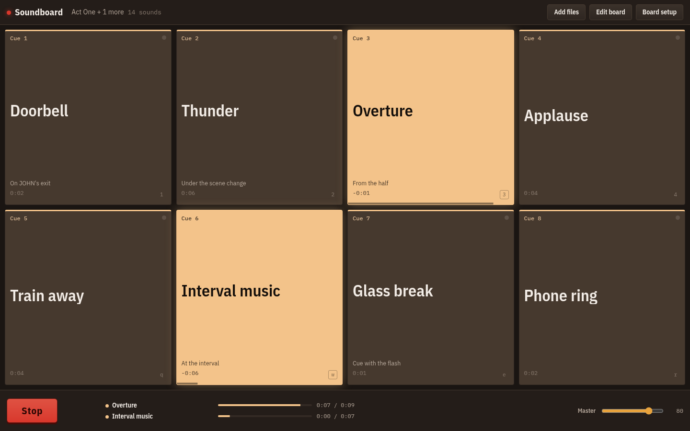
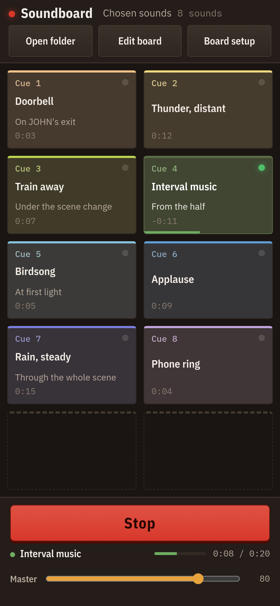
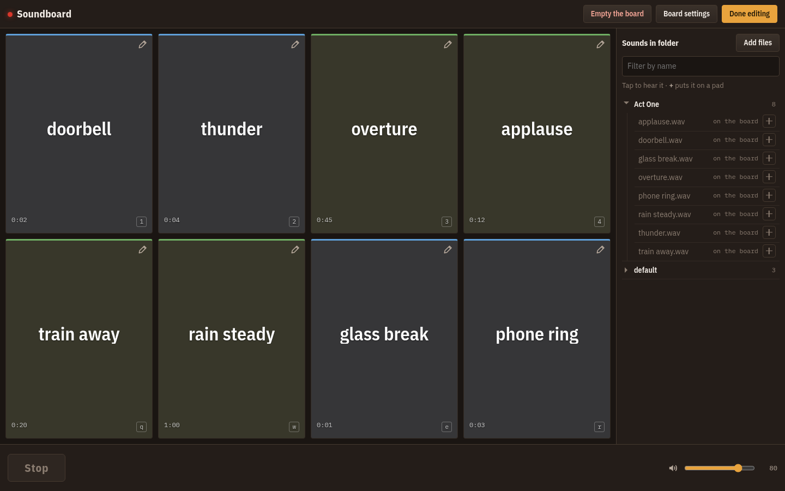

# Soundboard

A sound-cue board for theatre, run from the audio on your own machine. Point it
at the folder that holds the show's sound — or at a handful of files, and more
of them whenever you like — lay them out on a grid of pads, and fire them with
a tap, on a phone or a tablet as well as a laptop.

No build step, no server, no account, and nothing is uploaded: the files are read
straight off the disk by the browser and never leave it.







## Running it

It is live at **https://jesuisuncaillou.github.io/soundboard/** — or serve the
folder yourself:

```sh
python3 -m http.server 8000     # then open http://localhost:8000
```

It has to be served over `http://localhost` or `https://` — opening
`index.html` from the file system will not work, because browsers only hand out
folder access and ES modules in a secure context.

## Coming back to it

Reload the page and nothing has changed: the same board, the whole folder in the
tree, the same folders open, still in edit mode if that is where you were. Every
sound that has been loaded is kept inside the browser — not only the ones on
pads — so nothing has to be picked again and no permission has to be granted.
That holds in every browser, with the network off, and on a phone.

Where the browser allows it — Chrome, Edge and Opera on the desktop — the board
also keeps a handle on the places the sounds came from, and goes back to the real
files on disk when it can, so a file edited between rehearsals is the file that
plays. If the browser wants permission again, a **Reconnect** button appears at the
top of the board, beside **Edit board**; until it is used the board plays from its own copies, so
nothing stops a show.

Those copies are the reason the board installs well. **Install** it from the
browser menu (Chrome and Edge offer it in the address bar; on iOS, Share → Add to
Home Screen) and it runs in its own window, offline, and can hold on to folder
permission instead of asking at every launch.

To clear the copies, clear the site's data in the browser. A sound that is no
longer loaded has its copy dropped on the next change.

## Browsers

| Browser | Adding sounds | Going back to the files on disk |
| --- | --- | --- |
| Chrome, Edge, Opera on the desktop | A folder or single files, by picker or dropped on the window | Yes |
| Firefox and Safari on the desktop | A folder or single files, by picker or dropped on the window | No — the board plays its own copies |
| Chrome on Android | A folder, or single files | No — the board plays its own copies |
| Safari on iPhone and iPad | Single files — iOS has no folder picker | No — the board plays its own copies |

The difference is the [File System Access API](https://developer.mozilla.org/en-US/docs/Web/API/Window/showDirectoryPicker),
which only desktop Chromium browsers implement. It is what lets a folder be
reopened as a folder; everywhere else the browser hands over a snapshot of files
and nothing that outlives the session, which is what the kept copies are for.

Audio formats are whatever the browser plays: MP3, M4A, AAC, WAV, FLAC, OGG/Opus,
and on Safari also AIFF.

## Using it

**The first launch** opens a **Default board** set up for an improv show, with
the twelve sounds that come with the app: four effects that fire at once
(gunshot, explosion, phone, a dramatic sting, in blue), three places that loop
under a scene (storm, crickets, birds, in green) and five moods of music that
loop too (suspense, romance, sad, hero, happy, in lavender). Their levels are
evened out so none of them jumps out of the speakers. They sit under `default`
in the tree and stay there whatever else you open: they are served with the
board, so they need no folder, no permission and no copy. Press them, move them,
or empty the board and build your own.

**Setting up.** **Edit board** is where a board is built, and the folder's own
panel is where sounds come from: **Add files** sits at the top of it and takes a
whole folder or a few sounds at a time, subfolders and all, and whatever arrives
joins what is already open — so a board can be built from several places and
added to mid-rehearsal. A folder goes into the tree under its own name, and a
sound already on the board is recognised and left where it is.

Anything added waits in **Sounds**, the folder's own tree, which sits beside
the board on a wide screen and opens over it from **Browse files** on a narrow
one. Adding a folder never moves a pad you have set.

While editing, a tap is a listen: a sound in the tree plays where it is, and so
does a pad, so a cue can be checked before and after it goes on the board. The
**+** beside a sound puts it on the next free pad — or on a particular one:
click an empty pad and it lights up and waits, and the next **+** lands there.
Clicking it again lets it go. The pencil in a pad's corner opens its settings,
where **Hear it** plays it again. All of these can be reached with Tab and
pressed with Enter. Under a mouse or a finger the
whole pad is a handle: press anywhere but the pencil and move, and the pad comes
with you; press and release without moving and it just plays. While editing, the
board scrolls from its empty places and the gaps between pads. Dropping a pad
on the folder beside the board, or on the bar beneath it, takes it off the board
and leaves the sound where it is; that place is marked in red as soon as a pad
is picked up. There is no limit on how many sounds a board holds. **Empty the
board** clears the pads without touching the sounds, and asks twice. On an empty board the same button reads **Load the default
board** and lays the twelve sounds back out, set up as on a first launch.

**Board settings** sets how many rows and columns the board has — three columns by
four rows to begin with. That is the whole board: twelve pads hold twelve sounds, and the rest
wait in the folder until there is room. A smaller board says what it could not
keep. It also holds the fades new pads start with — a second in, a second and a half out,
so nothing begins or ends on a hard edge unless a pad is told to. **Done** keeps what was
changed there, and so does saving a board file from it; `Esc` leaves the board as it was.

**Each pad holds**: the file it plays, a name of its own if the file's will not
do, a colour, its level, fade in and fade out times, a loop switch, start and
stop points to the hundredth of a second, and what a second tap
does — fade it out, start it over, pause it, layer another copy on top, or
nothing at all. A pad can also be set to fade everything else out when it starts,
for a hard scene change.

**Running the show.** Tap a pad to fire it. A pad that is playing lights up in
its own colour, the way a lamp does, with a green light, a countdown and a travel
bar along its bottom edge — the board itself says what is running. A pad that
loops wears a loop mark beside its clock, which then counts to the end of one
pass rather than to the end of the cue; a sound under a second gives its length
in tenths (`0.6s`), not `0:00`. Names wrap between words only: a word too long
for its pad is set smaller rather than broken in two. Messages appear over the
top bar, never over the pads, and a pad's trouble is said once. A sound's
own length picks where it starts from: under five seconds it is a hit — a shot,
a door, a slap — so it comes up blue, starts at full level with no fade in, and
a second tap layers another copy on top; anything longer is a cue that runs, and
comes up green. Change any of it and the change stands. The eleven lighting gels
are there to mean something once one is chosen — a group, a scene, an act. The red **Stop** button takes everything
playing out, each sound on its own fade; `Esc` cuts the lot dead the moment you
hit it.

The pads are played by touch, or by a click: they have no keys. Where there is
a keyboard, two keys stand in for the buttons:

| Key | |
| --- | --- |
| `Space` | stop what is playing, fading it out |
| `Esc` | cut everything dead |

**On a tablet or a phone.** The board is the whole screen, and it keeps the shape
you gave it: a six-column board is six columns wide everywhere, scrolling rather
than rearranging itself under the operator. A side of the board that goes on
past the edge of the screen fades out there, so a column out of sight is never a
surprise; a phone held upright, from about 390px across
(most phones now), shows four columns whole. While editing, Stop and the volume
give their place to **Browse files**, which opens the folder over the whole
screen — the pads and the files are never half each — and **Back to the pads**
closes it. A pad comes away under the finger as soon as it moves, and dropped
anywhere on the bar at the bottom it comes off the board.

The screen is held awake for as long as a board is open — a show has long
minutes in it where nothing is pressed, and a phone that locks in one of them
has to be unlocked before the next cue. The lock is taken again whenever the
system drops it, which switching apps does. Where a browser will not do it
(iOS before 16.4, or a phone in low power mode) the board says so, and the
phone's own auto-lock setting is the thing to change.

**Carrying a board around.** Board settings saves the whole board as a JSON file and
loads one back. Pads refer to files by their path inside the folder, so a board
travels with its folder to another machine or another browser. A pad whose file
is missing is shown struck through rather than quietly dropped.

**A pad that will not load says so.** Each pad's sound is loaded as the board
is set up. If the browser cannot read a file, or will not open one more player
for it, the pad gets a red dashed border and "will not load", and a message
names it, so it turns up before the show rather than at the tap. Tapping it
tries again.

## How it is built

Static files, no dependencies, no build: an HTML shell, one stylesheet, and ES
modules for the wiring, the audio engine, the library of sounds, the board
model, storage, the setup sheets and drawing. Each pad keeps its own `<audio>`
element, buffered ahead of time, so a tap starts the sound in a few
milliseconds. Boards, folder handles and the kept copies of the sounds live in
IndexedDB.

The file-by-file map, the board format and the reasons behind it are in
[docs/architecture.md](docs/architecture.md) — start with [CLAUDE.md](CLAUDE.md) if you are
going to change something.

## Testing

End-to-end tests drive the board in Chromium, at desktop and phone size, with
[Playwright](https://playwright.dev). They are the only reason for the
`package.json`: the board itself still has no dependencies.

```sh
npm install
npx playwright install chromium   # once
npm run test:e2e
```

They run on every pull request, and the deploy to Pages runs them first. How
to write them is in [docs/testing.md](docs/testing.md).

## What it does not do

No streaming services: this plays files you have. No recording, no editing, no
multi-output routing — everything goes to the system's default output.
